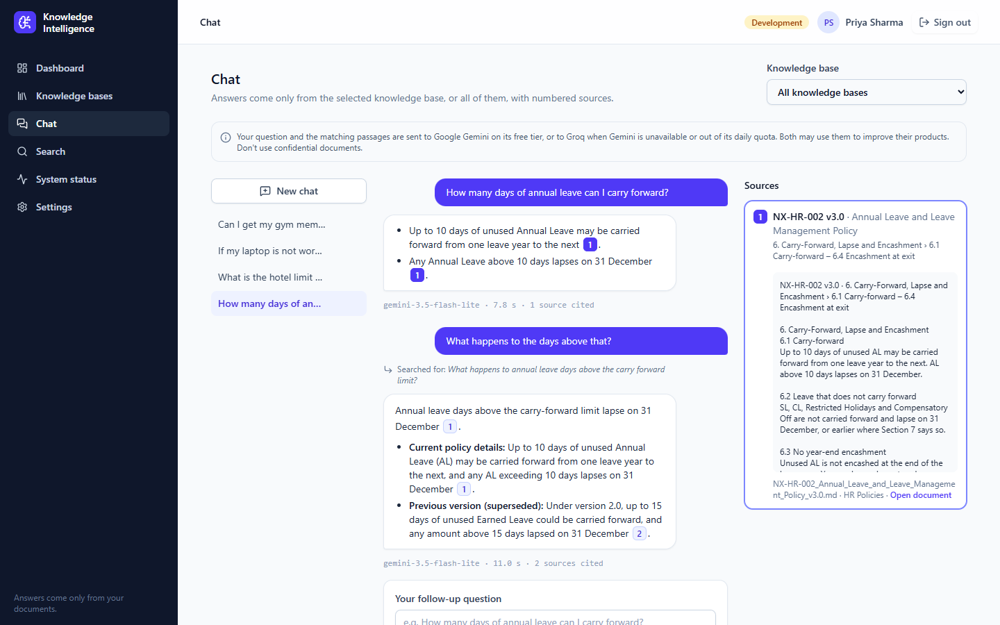
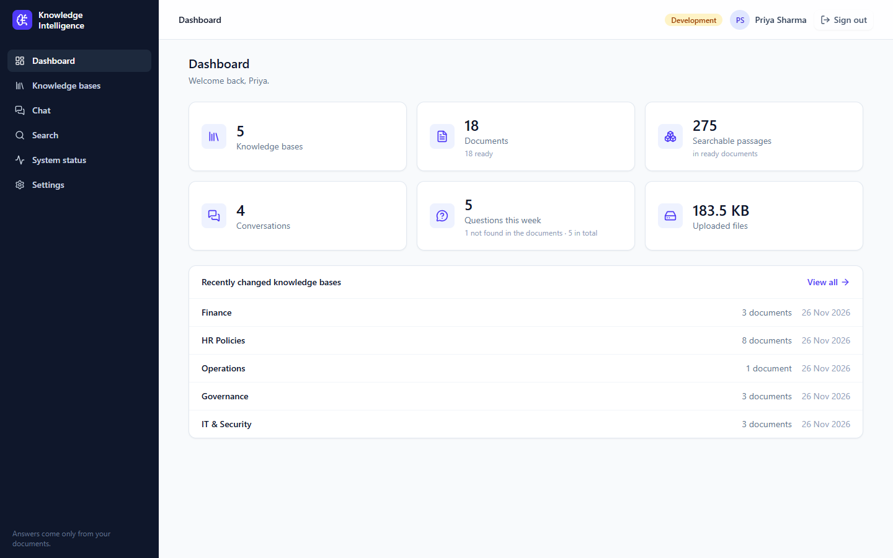
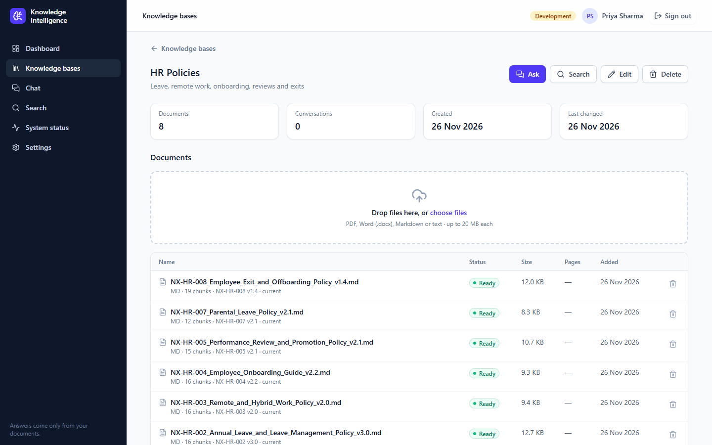
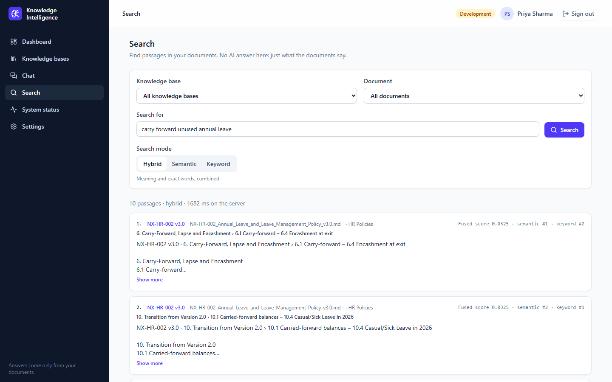
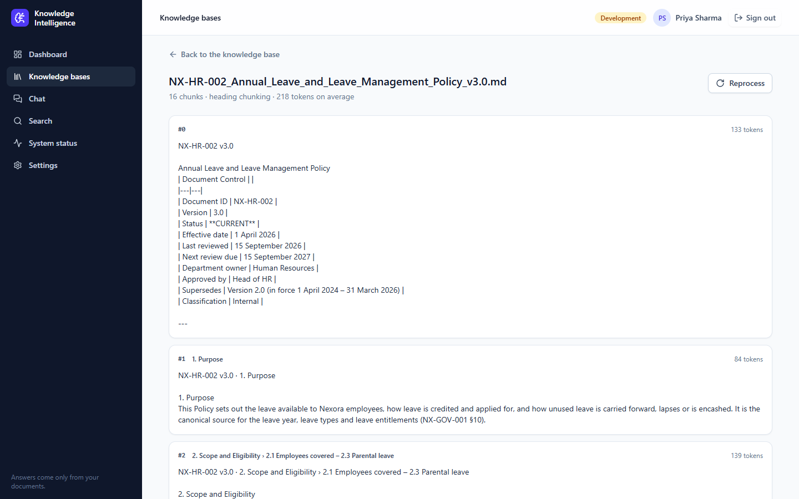
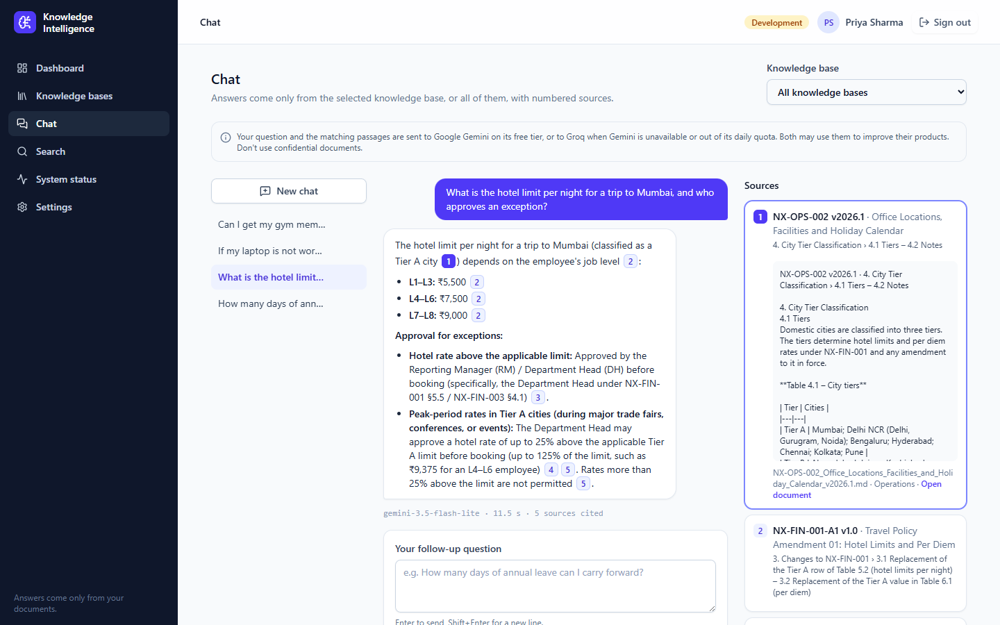
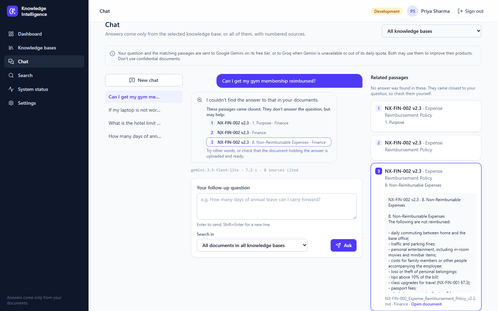
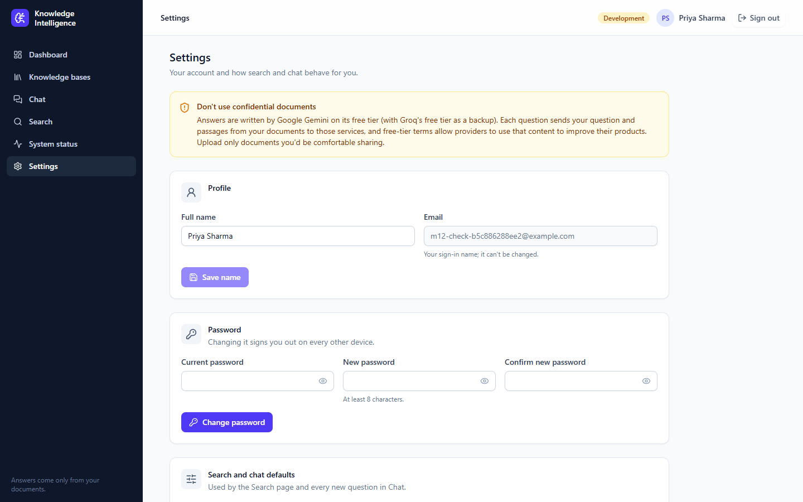

# Enterprise Knowledge Intelligence Platform

Upload your organisation's documents, ask questions in plain English, and get answers that are
**grounded in those documents, with citations** you can click to read. When the documents don't
answer, the app says *"I couldn't find the answer to that in your documents"*, and doesn't make
one up.

It is a hand-built RAG (retrieval-augmented generation) system: no LangChain and no LlamaIndex. Every
stage was written from scratch and measured on labelled questions before its default was chosen:
- chunking;
- local embeddings;
- hybrid search with rank fusion;
- version-aware ranking;
- multi-query retrieval;
- prompt construction;
- citation checking;
- streaming.



**Status: v1 complete (milestones M0–M17).** It runs on Windows with free services and no
Docker. The setup below was verified from a fresh clone in M17. Every decision, measurement and
known limitation is recorded in [PROJECT_TRACKER.md](PROJECT_TRACKER.md).

---

## Results at a glance

These were measured on 57 hand-labelled questions over 22 sample company policies. 50 of the
questions are answerable and 7 are deliberately unanswerable.

| | Result |
|---|---|
| **Retrieval:** the right passage ranked first (Hit@1) | **82 %**, up from 72 % for plain hybrid search |
| Retrieval: the right passage in the top 3 / top 5 | 96 % / 98 % |
| Retrieval: an outdated policy version ranked first | 0 of 15 (2 before version-aware ranking) |
| **Answers:** unanswerable questions refused | **7 of 7** |
| Answers: false refusals (answerable but refused) | 1 of 50 |
| Answers: correct / partial / incorrect | 40 / 8 / 1 |
| **Faithfulness:** answer claims stated by the sources | **98 %** (161 of 165 claims) |
| Citation accuracy: the cited passage supports the claim | 99 %, and 0 invalid citation numbers |
| Answer time, p50 / p95 (free-tier Gemini) | 6.5 s / 32.8 s |
| Automated tests | 856: 605 backend unit, 129 backend live, 122 frontend |

How these were measured, and where they fall short: [Evaluation](#evaluation).

## Features

- **Accounts and private knowledge bases.** Every query is filtered by owner. Another user's ids
  get the same 404 as ids that don't exist.
- **Upload** PDF, DOCX, Markdown and TXT, with live status (*Queued → Processing → Ready*, or
  *Failed* with the reason). Markdown front matter (code, version, status, effective date) becomes
  metadata.
- **Chat** with streamed answers and clickable citations. Follow-up questions are understood
  (*"Can they be carried forward?"*), and **Stop** keeps what was shown. Conversations are saved.
- **Ask across all your knowledge bases** (the default), or pick one, or limit a question to one
  document.
- **When nothing answers**, the passages that came closest are listed to check. Off-topic
  questions get none.
- **Search** in three modes: hybrid, semantic or keyword. Each result explains its score.
- **A chunk inspector** shows how each document was split, with section, pages and token counts.
- **Old policy versions** are marked *superseded* and ranked below the current one, unless the
  question asks about the past.
- **Prompt-injection defence:** passages that look like instructions to an AI are marked
  *Suspicious text*, and all document text is treated as untrusted data.
- **Backup models:** when Gemini's free quota runs out, a second Gemini model answers, then
  Groq. The answer says which model wrote it.
- **Settings:** profile, password, search and chat defaults, *sign out everywhere*, system status
  and a privacy notice.
- **Abuse limits** per user and address (questions, uploads, sign-ins, sign-ups), with
  `Retry-After`.
- **A built-in evaluation framework:** retrieval metrics (Hit@K, Recall@K, MRR) and answer
  metrics graded by a validated LLM judge (claim-level faithfulness, citation accuracy, refusals,
  correctness, latency).

## Screenshots

| | |
|---|---|
|  **Dashboard:** totals and recent knowledge bases |  **A knowledge base:** documents with status, version and chunk count |
|  **Search:** hybrid results with the semantic and keyword evidence behind each score |  **Chunk inspector:** heading-aware chunks with section and token counts |
|  **An answer from two knowledge bases:** the hotel limit (Finance) and the city's tier (Operations) |  **"Not found", with the closest passages:** no document gives a replacement time, so it doesn't invent one, and it lists where to look |
|  **Settings:** profile, password, the free-tier privacy notice; defaults, sign out everywhere and system status further down | |

## How it works

```
Browser (React, :5173) ──/api proxy──► FastAPI (:8000) ──► Neon PostgreSQL: users, documents, chunk text, keyword search, conversations
                                          │           ──► Qdrant Cloud: one vector per chunk, filtered by owner
                                          │           ──► Gemini (→ Gemini backup → Groq): planning + answer
                                          │           ──► local disk: the uploaded files
                                          └── bge-small embeddings run inside FastAPI, on CPU
```

**Ingestion.** Upload, then a background job takes over:
- it extracts the text (PyMuPDF, python-docx, Markdown with front matter, TXT with encoding
  detection);
- it splits it into chunks: heading-aware for structured Markdown, recursive otherwise, at most 400
  tokens counted with the embedding model's own tokenizer;
- it embeds each chunk locally with `bge-small-en-v1.5`;
- it writes the vectors to Qdrant and the text to PostgreSQL, in an order that never leaves a
  vector without its row.

**A question:**
1. **Planning:** one Gemini call in JSON mode rewrites a follow-up into a standalone question and
   writes two more phrasings.
2. **Hybrid retrieval** runs for each phrasing:
   - Qdrant cosine search plus PostgreSQL full-text search;
   - the results are fused with Reciprocal Rank Fusion, then fused again across phrasings;
   - outdated versions go below current ones.
3. **Context:** the 10 best passages, wrapped as numbered, untrusted sources.
4. **Answer:** Gemini is told to use the sources only, cite their numbers, and reply exactly
   `NOT_FOUND` when they don't answer. No similarity score could tell answerable questions from
   unanswerable ones (measured), so the model decides.
5. **Streaming:** the text streams over SSE. Citation numbers are validated and renumbered *as
   they stream*, and a possible `NOT_FOUND` is held back until it's ruled out, so text on screen
   never changes. The cited passages follow, and the turn is saved.

Full design, diagrams, schema and the reasoning behind each choice:
[ARCHITECTURE.md](ARCHITECTURE.md). Endpoints and the streaming protocol:
[docs/API.md](docs/API.md).

## Tech stack

| Layer | Technology |
|---|---|
| Frontend | React 19 (JavaScript), Vite, Tailwind CSS, React Router, Axios, Lucide |
| Backend | Python 3.12, FastAPI, Uvicorn, Pydantic, SQLAlchemy 2, psycopg 3, Alembic |
| Relational DB | **Neon** (hosted PostgreSQL 18, free plan) |
| Vector DB | **Qdrant Cloud** (free tier). The Qdrant Windows binary works too, with no code change. |
| Embeddings | Sentence Transformers `BAAI/bge-small-en-v1.5`, local on CPU |
| Reranker | `cross-encoder/ms-marco-MiniLM-L-6-v2`, local on CPU: built and measured, **off** because it ranked worse here |
| LLM | Google Gemini `gemini-3.5-flash-lite` (backup `gemini-3.1-flash-lite`) via `google-genai`, then Groq `openai/gpt-oss-120b` via `httpx`. Groq is also the evaluation judge. |
| Documents | PyMuPDF, python-docx |
| Tests | pytest, Vitest, Testing Library, ruff |

Not used, on purpose: Docker, LangChain/LlamaIndex, TypeScript, Redis/Celery, Kubernetes, paid
services.

---

## Windows setup guide

> ✅ **Verified from a fresh clone on Windows 11 in M17 (2026-11-26).** The clone, a new venv and
> every step below gave a working backend, and all 856 tests passed (see
> [TESTING.md](docs/TESTING.md#clean-clone-setup-test)). The accounts were reused, since they
> can't be re-created for a test.

All commands are for **PowerShell**. You'll run two things side by side: the backend and the
frontend. In the M17 test, the installs and model downloads took about 15 minutes; creating
the four free accounts comes on top.

### 0. Get the code: into a short path

```powershell
cd $HOME              # or any folder with a short path, e.g. C:\Projects
git clone https://github.com/piccolo3528/enterprise_ai.git enterprise-ai
cd enterprise-ai
```

> **Keep the path short.** PyTorch installs files with very long names. With Windows' default
> 260-character path limit, a clone in a deep folder fails at step 3 with
> `OSError: [WinError 206] The filename or extension is too long`. That happened in the M17
> clean-clone test from a ~100-character folder. Either clone somewhere short, or enable long
> paths, which needs admin rights:
> `New-ItemProperty HKLM:\SYSTEM\CurrentControlSet\Control\FileSystem -Name LongPathsEnabled -Value 1 -PropertyType DWORD -Force`

### 1. Install Python 3.12 and Node.js (skip if already installed)

```powershell
py -3.12 --version  # should print Python 3.12.x
node --version      # should print v20 or newer
```

- `py` is the Windows **Python launcher**. It finds installed Python versions even when `python`
  isn't on your PATH.
- If either is missing, install them with `winget`. Add `--scope user` to install without admin
  rights:
  ```powershell
  winget install Python.Python.3.12
  winget install OpenJS.NodeJS.LTS
  ```
  Close and reopen PowerShell afterwards so the new programs are found.
- `py -0p` lists every Python the launcher knows, with its path. A virtual environment breaks if
  its base Python is deleted, so use one in a permanent location such as
  `%LOCALAPPDATA%\Programs\Python\Python312`, not a temporary folder.

### 2. Create and activate a Python virtual environment

```powershell
cd backend
py -3.12 -m venv .venv
.\.venv\Scripts\Activate.ps1
```

- A **virtual environment** (`.venv`) is a private set of Python packages for this project only.
- `Activate.ps1` switches this PowerShell window to it, and your prompt starts with `(.venv)`.
  **Activate it in every new terminal for the backend.**
- If PowerShell says *"running scripts is disabled on this system"*, run
  `Set-ExecutionPolicy -Scope Process -ExecutionPolicy Bypass`, which affects only this window, and
  activate again.

### 3. Install backend dependencies

```powershell
python -m pip install --upgrade pip
pip install torch --index-url https://download.pytorch.org/whl/cpu
pip install -e ".[dev]"
```

- **Install `torch` first, from the CPU-only index.** Sentence Transformers needs PyTorch, and
  this app only uses the CPU. With torch already installed, `pip install -e` keeps it rather than
  fetching another build. (On Linux, PyPI's default torch bundles several GB of NVIDIA CUDA
  libraries.)
- `pip install -e ".[dev]"` installs everything in `pyproject.toml`, plus the dev tools (pytest,
  ruff). `-e` (editable) means code changes take effect without reinstalling.
- In the M17 clean-clone test these took about 12 minutes (torch 4½, the rest 8), mostly from
  pip's cache, on a machine that was busy with other work.

### 4. Create a Neon account and database

1. Sign up at **https://neon.com** (free plan, no credit card).
2. **Create a project.** Keep Neon's default PostgreSQL version (17 or 18; this project runs
   on 18) and pick the region closest to you. This project uses AWS Singapore, the nearest region
   to India.
3. *(Recommended)* In your branch's compute settings, cap autoscaling at **0.25–0.5 CU**. The free
   plan includes 100 CU-hours a month, and smaller computes use them more slowly.
4. **Create a branch named `test`** (Branches → New branch, from `main`). A branch is an instant,
   independent copy of the database. The automated tests use it, so they never touch your data.

### 5. Configure the Neon connection strings

```powershell
Copy-Item .env.example .env     # in backend/
notepad .env
```

`backend/.env` holds your secrets. Git ignores it, so it is never committed. In the Neon console,
click **Connect** and copy **two** strings for the `main` branch:

| `.env` variable | Neon setting | Used for |
|---|---|---|
| `DATABASE_URL` | **Connection pooling ON** (the host contains `-pooler`) | The running app |
| `DATABASE_MIGRATION_URL` | **Connection pooling OFF** | Migrations (Alembic) |

Then switch the dialog to the **`test`** branch and copy its pooled string into
`TEST_DATABASE_URL`.

**Edit each string in one place.** Neon shows `postgresql://…`: change the start to
`postgresql+psycopg://…`, which selects the psycopg 3 driver. Keep
`?sslmode=require&channel_binding=require` at the end. The app stops with a clear message if you
forget.

Why two URLs? The pooled endpoint (PgBouncer) lets many short requests share a few real
connections, but it may hand out a different connection for each transaction. Migrations need
one stable session, so they use the direct endpoint.

### 6. Set up Qdrant (no Docker)

**Default: the Qdrant Cloud free tier.** There's nothing to install.

1. Sign up at **https://cloud.qdrant.io** (no credit card) → **Clusters** → **Free Cluster**.
2. Pick a region **close to where the backend runs**. Every vector search is a round trip to it.
3. When the cluster is ready, create a **Database API key** and copy it at once. It's usually
   shown only once.
4. In `backend/.env`:
   ```
   QDRANT_URL=https://<cluster-id>.<region>.<provider>.cloud.qdrant.io:6333
   QDRANT_API_KEY=<your database API key>
   ```
5. Free clusters are **suspended after 1 week unused and deleted after 4 weeks**. Resume a
   suspended one from the console. If it's deleted, create a new one and run
   `python scripts\reindex.py` to rebuild every vector from PostgreSQL.

**Alternative: Qdrant as a local Windows program.** Download the official build once, check its
hash, and unzip it (from the repo root):

```powershell
New-Item -ItemType Directory -Force qdrant-local | Out-Null
Invoke-WebRequest -Uri "https://github.com/qdrant/qdrant/releases/download/v1.20.0/qdrant-x86_64-pc-windows-msvc.zip" -OutFile qdrant-local\qdrant.zip
(Get-FileHash qdrant-local\qdrant.zip -Algorithm SHA256).Hash   # must equal the hash below
Expand-Archive qdrant-local\qdrant.zip -DestinationPath qdrant-local -Force
```

Expected SHA-256: `6D13553584FD0411F00637519E293331FF0AA1FB79BD9E30DB45839BB75DE2BE`. A matching
hash proves the file is exactly the one Qdrant published.

Start it each time you work on the project, and leave the window open:

```powershell
cd qdrant-local
$env:QDRANT__SERVICE__HOST = "127.0.0.1"         # only this PC can connect (no password by default)
$env:QDRANT__STORAGE__STORAGE_PATH = ".\storage"
$env:QDRANT__TELEMETRY_DISABLED = "true"
.\qdrant.exe
```

Then set `QDRANT_URL=http://127.0.0.1:6333` and leave `QDRANT_API_KEY` empty. Keep `qdrant-local`
on a local disk, not in OneDrive or on a network drive. *(This option was verified in M1; the
project has since run on Qdrant Cloud.)*

### 7. Download the embedding and reranking models

```powershell
python scripts\download_models.py     # in backend/, venv active
```

This downloads `bge-small-en-v1.5` (~130 MB) and `ms-marco-MiniLM-L-6-v2` (~90 MB) into
`%USERPROFILE%\.cache\huggingface`, then runs one test embedding and prints
`PASS: both models downloaded, cached and working on CPU.` You only need to do it once.

### 8. Configure the API keys

1. **Gemini:** at **https://aistudio.google.com**, create an API key and put it in `backend/.env`
   as `GEMINI_API_KEY=…`. **Never** put it in frontend code, commit it or paste it anywhere.
   On AI Studio's rate-limit page, note the requests per minute for `gemini-3.5-flash-lite` and
   set `GEMINI_RPM_LIMIT` to that number.
2. **JWT secret**, which signs login sessions:
   ```powershell
   python -c "import secrets; print(secrets.token_urlsafe(64))"
   ```
   Put the result in `JWT_SECRET`.
3. *(Optional, recommended)* **Backup models.** When the answer model fails or its daily quota
   runs out, the app tries `GEMINI_MODEL_FALLBACK` (same key, its own quota), then Groq.
   - Create a free key at **https://console.groq.com/keys** and set `GROQ_API_KEY`.
   - Groq's free tier allows about one answer a minute, so it is the last resort.
   - Groq is also the answer evaluation's judge.

> **Privacy:** on the free tiers, Google and Groq may use submitted content to improve their
> products. Upload only documents you're comfortable sharing, such as the sample policies in
> `backend/evaluation/corpus/`.

### 9. Verify everything is connected

```powershell
python scripts\verify_setup.py
```

It reports PASS or FAIL for:
- Neon: pooled and direct connections, TLS, PostgreSQL full-text search;
- Qdrant: create, filtered search, delete;
- Gemini: one small request;
- Groq;
- the local models.

### 10. Run the database migrations

```powershell
alembic upgrade head                    # your development database
alembic -x target=test upgrade head     # the Neon "test" branch (the tests also do this)
```

Alembic applies each versioned schema change in order (through `DATABASE_MIGRATION_URL`).
Already-applied migrations are skipped, so you can run it again safely, for example after pulling
new code. `alembic check` confirms the models and the database match.

### 11. Start the backend

```powershell
uvicorn app.main:app --reload --reload-include .env --port 8000
```

- `--reload` restarts the server when you save a Python file, and `--reload-include .env` when you
  edit `.env`. Settings are read **once, at startup**.
- **http://localhost:8000/docs** is the interactive API documentation.
- The log shows `Database pool warmed up` within a few seconds. The first start after a reboot
  can take up to a minute while PyTorch loads in the background. The server answers meanwhile.
- If configuration is missing or invalid, the server stops and lists the variables to fix. Values
  are never printed.

### 12. Start the frontend

In a **second** PowerShell window:

```powershell
cd frontend
npm install        # first time, and whenever package.json changes
npm run dev
```

Open **http://localhost:5173** and click **Create an account**. Vite forwards every `/api/...`
request to the backend, so the browser sees one website. No API key ever reaches the frontend.
To try it with the sample data, create a knowledge base and drag in the Markdown files from
`backend/evaluation/corpus/`.

### 13. Run the tests

```powershell
# backend/, venv active
pytest                      # 605 unit tests: no network, don't read backend/.env (~4 min)
pytest -m live              # 129 live tests on the Neon "test" branch + a test Qdrant collection (~10 min)
pytest -m gemini            # 4 tests with real Gemini calls (opt-in: uses ~10 calls of free quota)
ruff check app tests
ruff format --check app tests

# frontend/
npm test                    # 122 tests (Vitest + Testing Library, simulated browser)
npm run build
```

What each layer covers, how the tests stay isolated, and the clean-clone check:
[docs/TESTING.md](docs/TESTING.md).

### Daily routine

| Window | Commands |
|---|---|
| 1 — Backend | `cd enterprise-ai\backend; .\.venv\Scripts\Activate.ps1; uvicorn app.main:app --reload --reload-include .env` |
| 2 — Frontend | `cd enterprise-ai\frontend; npm run dev` |

Neon and Qdrant Cloud need no starting. Neon wakes on the first request after being idle, which
makes that request a few seconds slower.

### Troubleshooting

| Symptom | Cause and fix |
|---|---|
| `WinError 206 … filename or extension is too long` during `pip install` | The clone's path is too deep; see step 0 |
| *"Can't reach the backend. Is the FastAPI server running on port 8000?"* | Start step 11. Vite proxies to `127.0.0.1:8000`. |
| System status shows **Degraded** | It names the failing service. A Qdrant free cluster may be suspended: resume it in the console. |
| The server stops at startup with a list of variables | Fix those in `backend/.env`. Neon URLs must start with `postgresql+psycopg://`. |
| *"The AI service isn't responding"*, or answers take 10–40 s | Gemini's free tier is busy; use **Retry**. When its daily quota is spent, the backup models answer. |
| A document shows **Deleting** | Qdrant was unreachable during the delete; delete it again |
| A document **Failed**: *no extractable text* | A scanned PDF; OCR isn't supported |
| Changed `.env` but nothing changed | The server reads settings at startup: restart it, or use `--reload-include .env` |

---

## Using the app

- **Knowledge bases.**
  - Create, rename and delete them. Names are unique per user, ignoring case.
  - Open one to **add documents**: drag and drop, or choose PDF, .docx, .md or .txt files, up to
    20 MB each.
  - Click a **Ready** document to open its chunk inspector. **Reprocess** rebuilds its chunks with
    the current chunking settings.
- **Chat.**
  - Ask, then press Enter. *All knowledge bases* is the default scope.
  - Click a citation number to read the passage, with its document, version and section, in the
    Sources panel.
  - Follow-ups can refer to earlier questions; the rewritten question is shown as
    *Searched for: …*.
  - **Search in** limits a question to one document. **Stop** ends an answer and keeps the part
    shown.
  - Conversations are listed on the left: rename, delete, or start a **New chat**.
- **Search.**
  - *Hybrid* combines meaning and exact words.
  - *Semantic* finds the same meaning in other words.
  - *Keyword* needs one of your words in the passage, which is good for codes like `NX-HR-002`.
  - If Qdrant is unreachable, hybrid search falls back to keyword matches, with a notice.
- **Settings.** Your name, password, default search mode and top-K, whether questions get extra
  phrasings, **Sign out everywhere**, and system status, including database storage against
  Neon's 1 GB.
- **Tuning** (`backend/.env`): `CHUNK_STRATEGY`, `CHUNK_SIZE_TOKENS`, `CHUNK_OVERLAP_TOKENS`,
  `CONTEXT_MAX_SOURCES`, `MULTI_QUERY_ENABLED`, `VERSION_MODE`, `RERANK_ENABLED`, the
  `RATE_LIMIT_*` limits, and more. The template [`backend/.env.example`](backend/.env.example)
  explains each one. After changing chunking, run `python scripts/reprocess_documents.py --all`.
  After changing the embedding model, or losing the Qdrant cluster, run
  `python scripts/reindex.py` (`--check` only compares).

---

## Evaluation

The labelled dataset is in [`backend/evaluation/datasets/`](backend/evaluation/datasets/):
- 57 questions over the 22 policies in `backend/evaluation/corpus/`;
- each question has its relevant passages, marked by character offsets for one exact version;
- 7 questions are deliberately unanswerable;
- the question types are factual, numerical, multi-passage, multi-document, superseded version,
  amendment, keyword ambiguity, and exception/eligibility.

The evaluation runs the app's real retrieval and answer code. The corpus is indexed inside a
database transaction that is rolled back, and into a throwaway Qdrant collection, so nothing is
kept.

### Retrieval

Each technique was built behind a switch and kept only if the numbers improved
([`2026-11-20_retrieval_combinations.md`](backend/evaluation/reports/2026-11-20_retrieval_combinations.md),
[`2026-11-20_retrieval_techniques.md`](backend/evaluation/reports/2026-11-20_retrieval_techniques.md)):

| Variant | Hit@1 | Hit@3 | Hit@5 | MRR | Old version first | p50 |
|---|---|---|---|---|---|---|
| Hybrid search + RRF (M11 baseline) | 72 % | 88 % | 96 % | 0.814 | 2 of 15 | 289 ms |
| + version-aware ranking | 74 % | 88 % | 98 % | 0.826 | 0 of 15 | 294 ms |
| + cross-encoder reranking (fused) | 70 % | 88 % | 96 % | 0.802 | 2 of 15 | 3,035 ms |
| + multi-query (3 phrasings) | 80 % | 94 % | 98 % | 0.870 | 2 of 15 | 1,004 ms |
| **multi-query + version-aware (the default)** | **82 %** | **96 %** | **98 %** | **0.881** | **0 of 15** | 911 ms |

- **Kept:** multi-query and version-aware ranking.
- **Measured and dropped:**
  - cross-encoder reranking: worse, and 10× slower on CPU;
  - amendment expansion: no gain.
- **Chunking:** five configurations were compared in 3 search modes
  ([`2026-11-13_chunking_comparison.md`](backend/evaluation/reports/2026-11-13_chunking_comparison.md)).
  Heading-aware chunks (at most 400 tokens, 60 of overlap) with hybrid search had the best Hit@1
  (72 %) and MRR (0.814), with the fewest tokens per answer. Fixed 400-token chunks had a slightly
  better Recall@5 (85 % vs 83 %).
- **All knowledge bases vs the right one** (M16b, the corpus split into 5 knowledge bases): Hit@1
  82 % vs 78–80 % over two runs, and Hit@5 98 % vs 100 %. That is why *All* is the default
  ([`2026-11-25_scope.md`](backend/evaluation/reports/2026-11-25_scope.md)).
- With 50 scored questions, one question is 2 points, so smaller differences are noise.

### Answers

Measured on 2026-11-24:
- the app's full pipeline (multi-query planning, version-aware ranking, 10 sources);
- answered by `gemini-3.5-flash-lite`;
- graded by Groq `openai/gpt-oss-120b`.

The full report includes every answer that wasn't fully right:
[`2026-11-24_answers.md`](backend/evaluation/reports/2026-11-24_answers.md).

| Measure | Result |
|---|---|
| Unanswerable questions refused | **7 of 7** |
| False refusals (answerable, but refused) | 1 of 50 |
| Correct / partial / incorrect, against the reference answers | **40** / 8 / 1 (of 49 answered) |
| Faithfulness: answer claims stated by the given sources | **98 %** (161 of 165 claims) |
| Answers with every claim supported | 46 of 49 |
| Citation accuracy: cited claims whose citation actually supports them | **99 %** |
| Invalid citations (numbers that point at no source) | 0 |
| Relevance: the answer addresses the question | 96 % |
| Answer time, p50 / p95 (planning + retrieval + answer) | 6.5 s / 32.8 s |

**How it's measured.** For each answer, the judge makes one JSON call:
- it reads exactly what the answering model was given;
- it splits the answer into single claims;
- it marks each claim as stated by the sources or not, and which source says it;
- it grades the answer against the reference answer and the question.

The judge comes from another company than the answering model, and its verdicts are cached by the
exact prompt. Before using its numbers, it was checked on 13 hand-labelled cases, including traps:
- an invented claim;
- a superseded source;
- a rule applied without its cap;
- a wrong headline with the right figure in a note.

It agreed on all 13
([`2026-11-23_judge_validation.md`](backend/evaluation/reports/2026-11-23_judge_validation.md)).

**What the misses are:**
- The 8 partial answers are right but leave out a detail the reference expects.
- The incorrect answer and the false refusal both ask for Kochi's hotel limit. That needs the
  city-tier table from another policy, which retrieval doesn't bring.
- 4 of 165 claims weren't supported. One adds something the sources don't say, one restates the
  question, and two say "the sources don't contain this".

**Context experiments (not adopted).** These ran on 23 Nov:

| Context | False refusals | Correct | Context tokens |
|---|---|---|---|
| Rank order (kept) | 0 of 50 | 44 | 2,508 |
| "Sandwich" (best passages at both ends) | 3 of 50 | 44 | 2,508 |
| Sentence compression | 4 of 50 | 42 | 2,040 |

**Backup model.** `gemini-3.1-flash-lite` refused 7 of 7 unanswerable questions, with 0 false
refusals. Of its answers graded so far, 9 are correct and 3 partial, all 100 % faithful. The rest
wait for Groq's daily budget.

**Limits:**
- An LLM judge can miss a subtle unsupported claim, and it was validated on only 13 cases.
- Correctness depends on the reference answers.
- Each number is one run of a free model; the 23 Nov run had 44 correct.
- p95 reflects slow free-tier Gemini calls that day (23 Nov: 9.1 s).

To re-run: `python evaluation/run_eval.py` (retrieval, ~2 min) and
`python evaluation/run_answers.py` (answers, ~114 Gemini calls + 57 Groq gradings). Every script
and option is in [docs/TESTING.md](docs/TESTING.md#evaluation-suites) and at the top of each
script.

---

## Known limitations

- **Free LLM tiers:** limited daily requests, and the provider may use the content. This is not
  for confidential data. When every model's quota is spent, questions fail until the next reset.
- **Two Gemini calls per question:** planning and answer. `MULTI_QUERY_ENABLED=false`, or turning off
  *Search extra phrasings of each question* in Settings, makes it one.
- **The answer model sees only the sources, never the conversation.** Questions *about* the
  conversation ("what did I ask first?") aren't answered from it.
- **Partial answers:** when the sources answer part of a question, the model refuses rather than
  answering that part. The closest passages are listed instead. A measured partial-answer prompt
  is a planned option (M16c).
- **Facts spread across documents** that retrieval doesn't bring together get refused or answered
  partially (e.g. Kochi's hotel limit).
- **Free hosting limits:** Neon has 1 GB of storage and 100 compute-hours a month, and sleeps
  after 5 idle minutes. A Qdrant free cluster is suspended after a week unused and deleted after 4
  weeks; the vectors can be rebuilt from PostgreSQL.
- **No OCR**, so scanned PDFs fail. DOCX citations show the section, not the page.
- **One server process.** Rate-limit counts and "sign out everywhere" live in its memory, so a
  restart resets the counts. Several workers would need a shared store.
- **Lock-out abuse:** five wrong passwords lock that email's sign-in for 15 minutes, which anyone
  who knows the email can trigger.
- **No browser end-to-end tests.** The UI is covered by component tests and a manual Chrome check
  each milestone.
- **English only:** the embedding model, the keyword stemming and the version rule's date
  patterns are English.

The full list, with the impact and mitigation of each, is in
[PROJECT_TRACKER.md §F.5](PROJECT_TRACKER.md).

## Project documents

- [ARCHITECTURE.md](ARCHITECTURE.md): design, data flows, the database schema, security
  checklist, decisions
- [docs/API.md](docs/API.md): every endpoint, the error contract, limits and the streaming
  protocol
- [docs/TESTING.md](docs/TESTING.md): test layers, isolation, the evaluation suites, the
  clean-clone check
- [PROJECT_TRACKER.md](PROJECT_TRACKER.md): milestones, the decision log, test results,
  limitations, lessons learned

## License

[MIT](LICENSE) © 2026 Mohammad Umair Jamal.

The PDF extraction library, [PyMuPDF](https://pymupdf.readthedocs.io/), is licensed under
**AGPL-3.0** (or commercially). pip installs it as a dependency, and this repository includes none
of its code. If you deploy this app as a network service, PyMuPDF's terms apply to that
deployment. The sample policies in `backend/evaluation/corpus/` describe a fictional company.
